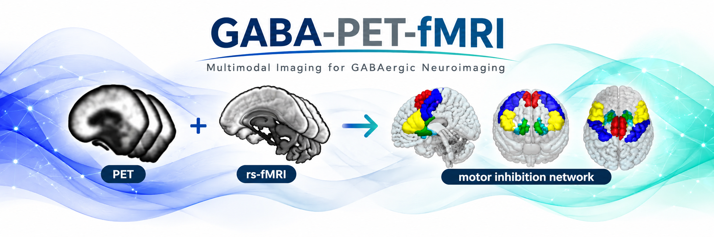

# Simultaneous GABA-PET and fMRI in motor inhibition network



This repository contains the analysis code for the research paper "[Full title of the paper]."

## Overview

This project investigates the relationship between GABAergic neurotransmission, measured with positron emission tomography (PET), and brain function, measured with functional magnetic resonance imaging (fMRI). By combining both modalities, the analyses aim to characterize how regional GABA receptor availability relates to [functional connectivity / brain activity / network organization].

## Repository Structure

```
GABA-PET-fMRI/
├── images/            # Figures used in this README
├── scripts/           # Analysis code
├── README.md
└── requirements.txt
```

The analysis scripts in `scripts/` should be executed in the following order:

1. `[script_1]` - [Short description, e.g. PET data preprocessing and regional quantification]
2. `[script_2]` - [Short description, e.g. fMRI preprocessing and connectivity estimation]
3. `[script_3]` - [Short description, e.g. integration of PET and fMRI measures]
4. `[script_4]` - [Short description, e.g. statistical analyses and figures]

## Important Notes

**This is not an automated pipeline.** These scripts are provided as a reference implementation rather than a ready-to-run analysis pipeline.

* No data are included in this repository
* Acquisition protocols and preprocessing steps may differ between sites and scanners
* The scripts assume you have your own preprocessed PET and fMRI data in the appropriate format
* The code is commented to explain each analytical step
* You will need to adapt file paths and data structures to your own setup

## Requirements

The code requires [Python 3.x] and the following libraries:

* [NumPy]
* [Pandas]
* [SciPy]
* [Matplotlib]
* [Nibabel / Nilearn / ...]

Please see `requirements.txt` for the full list.

## Citation

If you use this code, please cite:

> [Authors]. [Title]. [Journal], [Year]. [DOI]

## Contact

For questions regarding the analysis methods or code implementation, please open an issue in this repository or contact [razkinmalen@gmail.com](mailto:razkinmalen@gmail.com).
